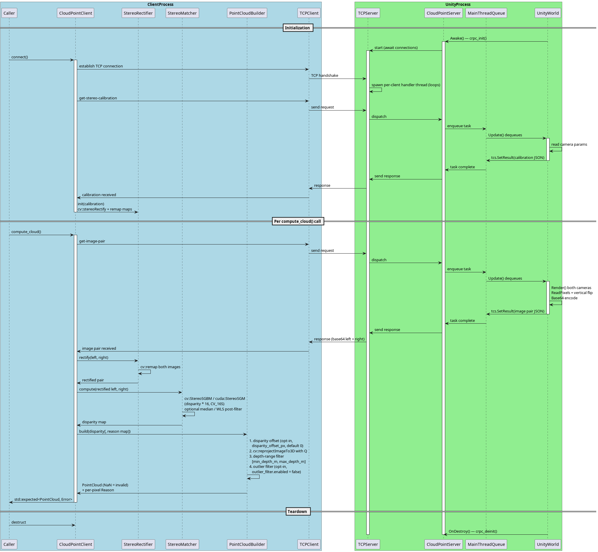

# Cloud Point RPC

Communication JSON RPC protocol and implementation with Unity Scene.

## Project Structure

- `include/`: Header files for the RPC server, TCP server, and C-API.
- `src/`: Implementation of the RPC logic, networking, and C-API.
- `src/cloud_point/`: OpenCV-based image processing and rectification logic.
- `scripts/`: SCARED overview tool (`scared_overview.py`) and the offline
  point-cloud viewer (`cloud_viewer/`: site template with vendored three.js,
  site builder).
- `docs/`: Documentation diagrams and models.
- `subprojects/`: Dependencies managed by Meson.

## Status

Done:

- [x] Server implementation with C-API for Unity
- [x] OpenCV stereo client (StereoRectifier, CPU/GPU matchers, PointCloudBuilder, CloudPointClient facade)
- [x] Tuned SGBM for the SCARED rig (P1/P2 penalties, uniqueness, speckle, LRC) and depth-range clipping
- [x] Binary PLY export with grid triangulation and `ply_stride` decimation
- [x] Optional WLS / median disparity post-filters (`wls_filter`, `CpuStereoMatcher::Params`)
- [x] SCARED benchmark with ground-truth metrics, depth PNGs and `scripts/scared_overview.py`
- [x] Offline web point-cloud viewer (`scripts/cloud_viewer/`, CLI option 6, `scared_overview.py --view`)
      and CSV/XLSX metric tables (`--csv`, `--xlsx`)
- [x] Unity-side C# implementation per [docs/unity-integration.md](docs/unity-integration.md)
- [x] Opt-in disparity offset and neighbourhood outlier filter in `PointCloudBuilder`
      (`cloud_point.disparity_offset_px`, `cloud_point.outlier_filter`), benchmark tuning flags,
      reconstruction diagnostics (depth-binned bias, offset/scale fits, error tail, coverage-loss
      attribution) and `scared_overview.py --bench-arg` / `--fit-offset`
      (see [Reconstruction diagnostics](#reconstruction-diagnostics))

To do:
- [ ] Remove sliver triangles at the border of the valid region (long spikes are still visible in
      shaded viewers at `ply_stride: 4` because 5 % of local depth allows 3 mm edges)
- [ ] Visually compare raw vs WLS meshes in a shaded web viewer and decide the visualisation default
- [ ] Expose the remaining `CpuStereoMatcher::Params` (block size, uniqueness, speckle, median kernel,
      WLS lambda/sigma) in the YAML `cloud_point` section
- [ ] Validate the CUDA `StereoSGM` path on a GPU machine (currently only exercised via CPU fallback)
- [ ] Reduce sub-pixel SGBM noise without the WLS accuracy loss (e.g. bilateral or guided filter on depth)

## API Documentation

See [API.md](API.md) for detailed request/response formats.

## Pipeline

Unity acts as a data source: it serves stereo image pairs (`get-image-pair`) and full stereo calibration (`get-stereo-calibration`) over JSON-RPC 2.0. The C++ `CloudPointClient` calls `connect()` once to fetch calibration, then on each `compute_cloud()` call it fetches a synchronised image pair and runs the stages below. `compute_frame()` runs the same pipeline and also returns the rectified left colour image (the viewer's colour source).

| Stage | Class | Algorithm |
|-------|-------|-----------|
| Rectification | `StereoRectifier` | `cv::stereoRectify` + `initUndistortRectifyMap`/`remap`; also yields the Q reprojection matrix |
| Disparity (CPU) | `CpuStereoMatcher` | `cv::StereoSGBM` (semi-global block matching, `MODE_SGBM`, 16× fixed point) with optional median blur or `cv::ximgproc` WLS post-filter |
| Disparity (GPU) | `GpuStereoMatcher` | `cv::cuda::StereoSGM` (`MODE_HH4`, 64/128/256 disparity levels); default, falls back to CPU without CUDA |
| Disparity offset | `PointCloudBuilder` | Off by default (`cloud_point.disparity_offset_px: 0`). Adds a constant, possibly fractional, offset δ to every raw disparity > 0 before reprojection (`corrected = raw + δ`); a corrected value ≤ 0 makes the pixel invalid. Corrects a systematic matcher bias; see [Reconstruction diagnostics](#reconstruction-diagnostics) |
| Reprojection | `PointCloudBuilder` | `cv::reprojectImageTo3D` with Q, then rejects disparity ≤ 0, OpenCV sentinels and depth outside `[min_depth_m, max_depth_m]` |
| Outlier filter | `PointCloudBuilder` | Off by default (`cloud_point.outlier_filter.enabled: false`). Runs after the depth-range filter: a point is dropped when its depth differs from the median depth of the valid points in its `window × window` neighbourhood by more than `max(abs_threshold_m, rel_threshold · median)`, or when fewer than `min_neighbours` valid neighbours exist. Decisions use the unfiltered cloud (order independent); it only removes points, never moves or adds one |
| Export | `write_ply` | Binary little-endian PLY with grid triangulation (edges ≤ 5 % of local depth) and optional `stride` block averaging |
| Viewer export | `encode_viewer_frame` | Stride-sampled int16 XYZ (+ optional ground truth and RGB) as a base64 `CPV1` payload for the offline web viewer (see [API.md](API.md#viewer-frame-format-cpv1)) |

`StereoMatcherFactory` picks the matcher from `CloudPointConfig::algorithm` and forwards `CpuStereoMatcher::Params`. Depth follows `z = fx·B / disparity`; on the SCARED rig that is about `4.45 m / disparity_px`, which is why the disparity range and depth limits in `config.scared.yml` matter.

See [API.md](API.md) for wire schemas and [docs/unity-integration.md](docs/unity-integration.md) for the Unity C# design spec.

## Development

The project uses **Meson** build system and **C++23**.

### Dependencies

- Meson (>= 1.1.0), Ninja
- GCC/Clang (C++23 support)
- Git (for subprojects)
- OpenCV 4 (optional; required for stereo point cloud compute)

The following dependencies are managed via Meson subprojects:
- [ASIO](https://think-async.com/Asio/) (Networking)
- [nlohmann/json](https://github.com/nlohmann/json) (JSON serialization)
- [yaml-cpp](https://github.com/jbeder/yaml-cpp) (Configuration loading)
- [glog](https://github.com/google/glog) (Logging)
- [jsonrpccxx](https://github.com/uS-S/jsonrpccxx) (JSON-RPC 2.0 implementation)

### Build & Run

```bash
meson setup build
meson compile -C build
./build/src/cloud_point_rpc_server config.yaml
```

*Note: You need a `config.yaml` file. See `config.yaml.example` for the required format.*

Run the interactive CLI client:

```bash
./build/src/cloud_point_rpc_cli config.yaml
```

CLI menu options (OpenCV options are hidden when built without opencv4):

| Option | Action |
|--------|--------|
| 1 | List available RPC methods |
| 2 | Get intrinsic params (legacy) |
| 3 | Get extrinsic params (legacy) |
| 4 | Compute point cloud — prints point count and bounding box |
| 5 | Compute point cloud and save to `output.ply` |
| 6 | Compute point cloud, add it to the offline viewer site and open the browser (see [Viewing clouds](#viewing-clouds)) |
| 0 | Exit |

#### Build on windows

It's assumed that you have `GCC` and `make`/`ninja` installed on your system (and available in `PATH`)

```powershell
## FIRST OF ALL!
git submodule init
git submodule update
# Next python:
python3 -m venv .\venv
.\venv\Scripts\Activate.ps1
# or
.\venv\bin\Activate.ps1
pip install meson cmake
meson setup -Ddefault_library=static build
meson compile -C build
# To correctly get dlls:
meson devenv -C build
## .\build\tests\unit_tests < for dummy test
## .\build\src\.. < produced execs and libs
```

### Testing

```bash
meson test -C build -v
```

Besides the C++ `unit_tests`, this runs `python_overview_outputs` when
`python3` is found: the unittest suite under `tests/python/` covers the
CSV/XLSX writers and the viewer site builder on canned benchmark JSON (no
binary or dataset needed; XLSX cases are skipped without `openpyxl`).

## Docker

The `Dockerfile` builds a **development environment** image only: toolchain
(GCC, Meson, Ninja, CMake), git for the Meson subprojects and OpenCV 4 with
contrib modules. Nothing is compiled at image build time. The source tree is
bind-mounted into the running container and compiled there, so edits on the
host are picked up immediately and the build artefacts land in your checkout.

### 1. Build the environment image

```bash
docker build -t cloud-point-rpc-dev .
```

### 2. Start the container with the source mounted

```bash
docker run -d --name cprpc-dev --network=host -v "$(pwd)":/app cloud-point-rpc-dev
```

The container idles (`tail -F /dev/null`); `--network=host` lets the CLI
reach a server running on the host and lets the server be reached from Unity.

### 3. Build and run inside the container

```bash
docker exec -it cprpc-dev meson setup build-docker
docker exec -it cprpc-dev meson compile -C build-docker
docker exec -it cprpc-dev meson test -C build-docker
docker exec -it cprpc-dev ./build-docker/src/cloud_point_rpc_cli config.yml
```

Use a dedicated build directory such as `build-docker`: Meson stores absolute
compiler paths, so a build directory configured on the host cannot be reused
inside the container and vice versa. With rootless Docker the container's
root maps to your host user, so `build-docker/` stays owned by you; with a
rootful daemon add `--user "$(id -u):$(id -g)"` to `docker run` to avoid
root-owned build files.

## Validation with SCARED Dataset

The `scared_dataset_server` executable lets you validate the stereo point-cloud
pipeline against real endoscopic images from the
[SCARED dataset](https://huggingface.co/datasets/maxhallan7/scared).

### Obtaining the data

1. Download `test_dataset_8.zip` from
   <https://huggingface.co/datasets/maxhallan7/scared>.
2. Extract so that `keyframe_0/` through `keyframe_4/` exist under
   `test_dataset_8/`.

Each keyframe directory contains:
- `Left_Image.png`, `Right_Image.png` — 1280×1024 unrectified RGBA images.
- `endoscope_calibration.yaml` — OpenCV FileStorage with `M1`, `D1`, `M2`,
  `D2`, `R`, `T` nodes.

**Note:** `T` is stored in **millimetres** in the YAML file (baseline ≈ −4.35 mm).
`scared_dataset_server` divides `T` by 1000 before placing it on the wire
(the wire protocol uses metres).

### Running the server

```bash
./build/src/cloud_point/scared_dataset_server \
    /path/to/test_dataset_8/keyframe_0 8080
```

If port 8080 is already taken on your machine (Docker's `rootlesskit`
commonly holds it) pass another port and update `server.port` in the CLI
config accordingly. Connecting the CLI to a foreign service on 8080 shows up
as `invalid JSON response from server` / `std::bad_alloc` errors.

### Connecting with the CLI

In a second terminal run the interactive CLI with the SCARED-tuned config:

```bash
./build/src/cloud_point_rpc_cli config.scared.yml
# Option 4 — compute point cloud and print valid point count + bounding box
# Option 5 — compute point cloud and save a triangulated PLY mesh
# Option 6 — compute point cloud and open it in the offline web viewer
```

`config.scared.yml` sets the optional `cloud_point` section that options 4–6
honour:

```yaml
cloud_point:
  algorithm: cpu        # "gpu" falls back to CPU when CUDA is unavailable
  num_disparities: 160  # fx ~1024 px, baseline ~4.35 mm -> up to ~160 px
  min_depth_m: 0.02     # endoscopic working range: 20 mm .. 300 mm
  max_depth_m: 0.30
  ply_stride: 1         # option 5: 4 = 16x smaller, block-averaged mesh
  wls_filter: false     # true = smoother mesh for viewers, less accurate
  # Both opt-in, defaults shown (see "Reconstruction diagnostics" below):
  # disparity_offset_px: 0.0   # added to every valid disparity (px)
  # outlier_filter:
  #   enabled: false
  #   window: 5                # odd, >= 3
  #   abs_threshold_m: 0.002
  #   rel_threshold: 0.03
  #   min_neighbours: 6        # 0 <= min_neighbours < window^2
```

Depth limits are a physical bound on the scene: with this rig depth is
roughly `4.45 m / disparity_px`, so any mismatch with a disparity below
~15 px reprojects metres away. Without the section the CLI falls back to the
generic defaults (GPU, 128 disparities, 0.01–10 m). The SGBM matcher itself
is configured with OpenCV's recommended smoothness penalties (P1 = 8·bs²,
P2 = 32·bs²), a 5×5 block, uniqueness ratio 10, speckle filtering and a
left-right consistency check; see `CpuStereoMatcher::Params`.

### Checking the result

Option 4 should report a bounding box with z inside roughly
`[0.03, 0.16]` m for `test_dataset_8` keyframes. Option 5 writes a binary
little-endian PLY containing every valid point **and** a mesh triangulated
from the pixel grid (triangles are dropped where the longest edge exceeds 5 % of the local
depth, so the mesh breaks at occlusions). The mesh is what makes third-party
web viewers usable: viewers such as Meshy's online PLY viewer fabricate a
triangle from every three consecutive vertices of a vertex-only PLY, which
draws long slivers across the surface and makes a correct cloud look like a
fan of rays. Pass `PlyOptions{false, 0.0f, false}` to `write_ply` for a
points-only ASCII file. The recommended way to inspect a cloud is the
built-in viewer (option 6, or `scared_overview.py --view` for dataset
keyframes with ground-truth colouring; see [Viewing clouds](#viewing-clouds)),
which draws points directly and needs no mesh.

**Surface roughness vs accuracy.** SGBM's sub-pixel disparity noise
(~0.2 px, correlated over several pixels) is ~1 mm of depth on this rig,
far more than the 0.07 mm lateral pixel pitch, so a mesh built from the raw
cloud is "hairy": face normals sit a median 45° off the camera axis on
tissue that faces the camera. Colour depth maps hide this; shaded mesh
viewers show it as fuzz. `wls_filter: true` applies OpenCV's edge-aware
WLS disparity filter (needs `opencv_ximgproc`, doubles matching time) and
brings the median normal to ~23° with neighbour depth jumps down from 0.15 mm
to 0.06 mm, but it also costs accuracy on SCARED (keyframe 1: MAE 0.84 →
0.92 mm, within 2 mm 80 → 78 %; dataset_3: MAE 1.75 → 2.20 mm). It is
therefore off by default: use it for pictures, not for measurements. SGBM's
own holes are never filled by the filter.

When the keyframe contains `point_cloud.obj`, run the benchmark to compare the
reconstruction with its pixel-aligned XYZ ground truth:

```bash
./build/src/cloud_point/scared_dataset_benchmark \
    /path/to/dataset_1/keyframe_1 160 [depth.png|-] [min_depth_m max_depth_m]
```

The benchmark always reports the valid-point fraction, depth percentiles
and matching/reconstruction timings as JSON, and optionally writes a
colour-mapped depth image (third argument, `-` to skip) for visual
inspection. The optional depth range applies the same filter as the CLI's
`cloud_point` section; without it the generic 0.01–10 m defaults are used,
which lets a few residual mismatches at metres of depth inflate RMSE. When
`point_cloud.obj` is present it also reports coverage, component-wise and
3-D errors and threshold accuracy. Note that the `test_dataset_*` archives
ship without `point_cloud.obj`; ground truth is only in the full
`dataset_N.zip` archives (13–40 GB each). The zips are served with HTTP
range support, so single keyframes can be extracted remotely with Python's
`zipfile` over a seekable HTTP file object instead of downloading the whole
archive.

`scripts/scared_overview.py` runs the benchmark over many keyframes and
prints a Markdown table:

```bash
scripts/scared_overview.py --png-dir out/depth --depth-range 0.02 0.30 \
    datasets/scared/dataset_1/keyframe_* datasets/scared/test_dataset_8/keyframe_*
```

Ground-truth OBJ coordinates are converted from millimetres to metres and
rectified into the same left-camera frame as the reconstructed cloud before
evaluation. Reference numbers with the tuned SGBM configuration and the
0.02–0.30 m depth range (raw disparity, no WLS):

| Keyframe | Valid points | MAE₃D | RMSE₃D | Within 2 mm |
|----------|--------------|-------|--------|-------------|
| dataset_1 kf1 | 84.6 % | 0.84 mm | 1.43 mm | 80 % |
| dataset_1 kf2 | 86.3 % | 1.15 mm | 2.05 mm | 76 % |
| dataset_1 kf3 | 86.9 % | 1.09 mm | 8.15 mm ¹ | 76 % |
| dataset_1 kf4 | 84.7 % | 0.66 mm | 1.26 mm | 85 % |
| dataset_1 kf5 | 84.6 % | 0.79 mm | 1.51 mm | 77 % |
| dataset_2 kf1 | 72 % | 1.10 mm | 3.76 mm | 68 % ² |
| dataset_3 kf1 | 83.0 % | 1.77 mm | 4.06 mm | 66 % |
| test_dataset_8 kf0–4 | 79–86 % | no ground truth; median depth 56–115 mm | | |

¹ A ground-truth artefact, not a reconstruction error: `dataset_1/keyframe_3`'s
`point_cloud.obj` holds 7 vertices at 0.3–3.6 m in a scene whose other
ground truth is under 0.2 m (max 3-D error 4305 mm). The reconstruction there
is inside 0.02–0.30 m, so these 7 points alone produce the 8.15 mm RMSE, and
no reconstruction-side filter can remove them. Without this keyframe the mean
RMSE over the ground-truth keyframes is 2.35 mm instead of 3.18 mm.
`dataset_2/keyframe_1` has one such vertex.

² dataset_2's low coverage (73.9 %) is **not** caused by the 160-disparity
search range: only 1.4 pp of its ground-truth pixels have a disparity beyond
the range, while 14.4 % fall in SGBM's invalid left band and 10.3 % are
rejected by the matcher (uniqueness / left-right checks; the other keyframes
lose 0.5–3 % this way). Widening the range does not help; see
[Measured tuning candidates](#measured-tuning-candidates).

The previous unregularised SGBM gave MAE₃D ≈ 44 mm and RMSE₃D ≈ 289 mm on
`dataset_1/keyframe_1`. Matching takes ~325 ms per 1280×1024 frame on the
CPU (~650 ms with WLS); the builder (reprojection and filters) takes ~38 ms.
The baseline of the table above is recorded in `out/quality/baseline.csv`
(not versioned) and the tuning decisions in `out/quality/decisions.md`.

### Measured tuning candidates

Four candidates for `config.scared.yml` were measured against that baseline
on the 7 ground-truth keyframes (test_dataset_8 for the valid fraction
only). **None is a SCARED default.** Each missed its acceptance target from
the change design (D7): an offset must reduce the |median bias| on every
held-out dataset without worsening any MAE by more than 2 %; a speckle
re-tune or outlier filter must cut the mean RMSE by at least 30 % while
losing at most 1 pp coverage, 0.5 pp within-2 mm, no MAE and at most
30 ms per frame; a wider range must raise dataset_2 coverage by at least
3 pp at up to 40 % more matching time. All remain opt-in:

| Candidate | Result vs baseline | Why not a default | Opt-in via |
|-----------|--------------------|-------------------|------------|
| Disparity offset, combined fit +0.521 px | Leave-one-dataset-out: dataset_2 held out (δ +0.397 px) MAE 1.099 → 0.975 mm, bias +0.666 → +0.499 mm; dataset_3 (δ +0.542) MAE 1.766 → 1.606 mm, bias +0.488 → −0.183 mm; dataset_1 (δ +0.893) MAE 0.923 → 0.958 mm (+3.8 %), bias +0.307 → −0.430 mm | Holdout fails on dataset_1 (\|bias\| grows, MAE +3.8 %). The fitted δ is not one constant: 0.22–0.66 px within dataset_1, 1.56 px on dataset_2 | `cloud_point.disparity_offset_px`, `--disparity-offset` |
| Speckle window 200 / range 2 (currently 100 / 2) | Mean RMSE −11.9 % (dataset_2 3.76 → 1.78 mm, dataset_1 kf4 1.26 → 0.92 mm); worst coverage −0.74 pp, worst within-2 mm −0.17 pp, no MAE worse, free at runtime | Within every guard except the 30 % RMSE target, which the kf3 artefact makes unreachable (−18.7 % without kf3). Recommended opt-in | `--speckle-window=200` (benchmark flag only; not yet a config key) |
| Outlier filter (window 5, abs 2 mm, rel 0.02) on top of speckle 200/2 | Mean RMSE −12.4 %, i.e. 0.3–0.9 pp beyond speckle alone across the sweep; coverage −0.81 pp, within-2 mm −0.20 pp, MAE improves, +10–16 ms per frame | Misses the 30 % target. The remaining tail is coherent blobs (dataset_3: 5.5–6 % of points over 5 mm in every setting) whose neighbours agree with them, so a grid-median filter cannot flag them | `cloud_point.outlier_filter.*`, `--outlier-filter --outlier-window=5 --outlier-abs-m=0.002 --outlier-rel=0.02` |
| 192 / 224 disparity levels (currently 160) | dataset_2 coverage 73.9 → 72.3 / 69.7 % (−1.6 / −4.3 pp), worst keyframe −3.1 / −6.1 pp, worst MAE +0.8 / +1.9 %, matching +39 / +73 ms (+12 / +22 %) | Coverage falls instead of rising: each extra 32 levels recovers at most the 1.4 pp lost to the range once but adds 32 invalid columns (2.5 % of 1280) to SGBM's left band on every frame | `cloud_point.num_disparities` |

The final SCARED settings therefore equal the baseline settings
(`out/quality/final.csv` reproduces `baseline.csv`).

### Reconstruction diagnostics

With `point_cloud.obj` present the benchmark explains *why* a
reconstruction is off, next to the headline metrics (JSON keys in
[API.md](API.md#scared-benchmark-scared_dataset_benchmark)):

- **Depth-binned signed bias** (`depth_bias`, `bias_z_median_m`): the
  median of `z_rec − z_gt` per 10 mm bin of ground-truth depth (bins with
  fewer than 200 matched points are dropped), plus the median over all
  matched points. On SCARED it is +0.17 to +0.67 mm on every keyframe
  (reconstruction too far), a fraction of the 0.66–1.77 mm MAE.
- **Calibration-error fits** (`fit_disparity_offset_px`, `fit_depth_scale`,
  each with a `*_residual_m`): the constant disparity offset δ =
  median(d_gt − d_rec) and the depth scale s = median(z_rec / z_gt) that
  best remove the bias, using matched points with error below 20 mm. Each
  residual is the RMS of the bin medians left after applying the model, so
  the smaller residual says which model explains the data. On SCARED the
  two are indistinguishable (the scale model is marginally better on 5 of
  7 keyframes) and the bin-to-bin structure exceeds either correction.
- **Error tail** (`tail_over_5mm`, `tail_over_20mm`, `tail_over_50mm`,
  `max_3d_m`): fractions of matched points above each 3-D error and the
  largest error. These few points dominate RMSE.
- **Coverage-loss attribution** (`coverage_loss.*`): every valid
  ground-truth pixel without a point is assigned exactly one cause, in this
  order: `out_of_search_range` (its ground-truth disparity minus the applied
  offset is outside `[minDisparity, minDisparity + numDisparities)`),
  `image_border` (column `x < minDisparity + numDisparities`, the left band
  `cv::StereoSGBM` always leaves invalid because the search range there runs
  past the right image, so widening the range moves loss into this band
  instead of hiding it), then the builder's own reason for the pixel:
  `matcher_rejected`, `depth_range` or `outlier_filter`. `coverage` plus
  the five fractions is 1. `unscored_fraction` is the share of reconstructed
  points that have no ground truth.

Every accuracy-relevant setting is a `--key=value` benchmark flag (matcher:
`--block-size`, `--uniqueness`, `--speckle-window`, `--speckle-range`,
`--disp12-max-diff`, `--pre-filter-cap`, `--median-kernel`, `--wls` /
`--no-wls`; builder: `--disparity-offset`, `--outlier-filter` /
`--no-outlier-filter`, `--outlier-window`, `--outlier-abs-m`,
`--outlier-rel`, `--outlier-min-neighbours`), so a sweep needs no rebuild.
Without flags the defaults equal the CLI's, and the effective values are
echoed under `settings`. An unknown or malformed flag exits with status 1
and the usage text before the dataset is loaded. Note that the SGBM matcher
parameters (speckle window and range included) are benchmark flags only;
the YAML `cloud_point` section has no key for them yet.

```bash
./build/src/cloud_point/scared_dataset_benchmark \
    --speckle-window=200 --outlier-filter --disparity-offset=0.1 \
    datasets/scared/dataset_1/keyframe_1 160 - 0.02 0.30
```

`scared_overview.py` forwards flags to every benchmark call with the
repeatable `--bench-arg=FLAG` (use the `=` form); they are listed on the
XLSX `run` sheet, and a keyframe whose flag the benchmark rejects becomes a
`failed` row:

```bash
scripts/scared_overview.py --depth-range 0.02 0.30 \
    --bench-arg=--speckle-window=200 --csv out/sp200.csv \
    datasets/scared/dataset_*/keyframe_* datasets/scared/test_dataset_8/keyframe_*
```

`--fit-offset` runs the ground-truth keyframes, combines their
`fit_disparity_offset_px` into one offset weighted by matched points, and
prints a leave-one-dataset-out table: each `dataset_N` is re-run with the
offset fitted on the other datasets (`--disparity-offset=<fit>`) and its
point-weighted MAE and median bias before and after are shown. It writes no
files and rejects `--csv`, `--xlsx`, `--png-dir`, `--json-dir` and the
viewer options; with keyframes from a single dataset it prints the offset and
says the check needs two datasets:

```bash
scripts/scared_overview.py --fit-offset --depth-range 0.02 0.30 \
    datasets/scared/dataset_*/keyframe_*
```

Any offset fitted this way corrects towards SCARED's own structured-light
ground truth, which carries its own calibration error, so it is a property of
this dataset rather than of the rig. That, and the holdout failure above, is
why the code default stays 0.

### Metrics tables (CSV / XLSX)

`scared_overview.py` also writes the per-keyframe metrics as a table.
The Markdown table is still printed to stdout; the benchmark runs once per
keyframe no matter how many outputs are requested, so all of them hold the
same numbers.

```bash
scripts/scared_overview.py --depth-range 0.02 0.30 \
    --csv out/metrics.csv --xlsx out/metrics.xlsx \
    datasets/scared/dataset_1/keyframe_* datasets/scared/test_dataset_8/keyframe_*
```

- `--csv PATH`: RFC 4180 CSV (UTF-8, header row, dot decimal separator).
  Needs only the Python standard library.
- `--xlsx PATH`: workbook with a `metrics` sheet (numeric cells, frozen
  header row, number formats, autofilter) and a `run` sheet (number of
  disparities, depth range, every `--bench-arg` flag as a `bench_arg` row,
  UTC timestamp, git commit, benchmark path, keyframes). Needs `openpyxl`: `pip install openpyxl` or
  `apt install python3-openpyxl` (the Docker dev image has it). Without it
  the tool prints `error: --xlsx needs the 'openpyxl' package ...` and exits
  with status 2 before running any benchmark.

Both tables have the same columns, in this order: `keyframe`, `status`
(`ok` / `failed`), `has_ground_truth`, `valid_points_pct`, `depth_p5_mm`,
`depth_median_mm`, `depth_p95_mm`, `matching_ms`, `reconstruction_ms`,
`coverage_pct`, `mae_3d_mm`, `mae_z_mm`, `rmse_3d_mm`, `median_3d_mm`,
`within_1mm_pct`, `within_2mm_pct`, `within_5mm_pct`, then the diagnostics
`bias_z_median_mm`, `fit_disparity_offset_px`, `tail_over_5mm_pct`,
`tail_over_20mm_pct`, `max_3d_mm`, `lost_search_range_pct`,
`lost_matcher_pct`. Lengths are in
millimetres, fractions in percent, times in milliseconds. Cells that do not
apply are empty, never zero: the accuracy and diagnostics columns of a keyframe without
`point_cloud.obj`, and every metric of a keyframe whose benchmark failed
(its row is kept with `status = failed`).

### Viewing clouds

`scripts/cloud_viewer/` holds a self-contained web viewer (static
HTML/JS with vendored three.js r128, no network access). A generated site
is a directory with `index.html`, the scripts and one `frames/<id>.js` per
frame plus `frames/manifest.js`; it opens straight from disk via `file://`
(frames are loaded with `<script>` tags, not `fetch()`), can be copied or
moved as a whole and needs no server. Each frame costs about 1.6 MB at the
default stride 4 (every 4th pixel in each direction; samples are raw pixel
values, not averages, so error statistics recomputed in the viewer match the
benchmark). Frames are loaded lazily when selected.

The page offers orbit/pan/zoom, reset and side views, point size, a frame
list, and four colourings: camera image, depth, 3D error against ground truth
and signed depth bias (reconstruction z minus ground-truth z), with a legend
and an adjustable upper limit for the error/bias scale. For frames with
ground truth it can overlay the ground-truth points and shows the benchmark
metrics, a histogram of per-point 3D error and the median depth bias per
10 mm depth bin. The error and bias modes and the overlay are disabled for
frames without ground truth.

**From the dataset tooling.** `--view` runs the benchmark as usual, builds a
site with every keyframe that succeeded (failed keyframes are reported and
left out), prints `viewer: <index.html> (<size> MB, N frames)` to stderr and
opens the site in the default browser:

```bash
scripts/scared_overview.py --depth-range 0.02 0.30 --view \
    datasets/scared/dataset_1/keyframe_* datasets/scared/test_dataset_8/keyframe_*
```

- `--view-out DIR`: site directory (default `out/viewer`; implies `--view`).
  Existing frame files in `DIR` are kept, the manifest is rewritten.
- `--no-open`: build (or serve) without launching a browser. When no browser
  can be found (headless, Docker) the tool prints the path and still exits
  with success.
- `--viewer-stride N`: sample every N-th pixel (default 4; 1 = full
  resolution, 16× larger frames).
- `--serve [PORT]` (default port 8765; implies `--view`): serve the site over
  HTTP on `--bind ADDR` (default `127.0.0.1`) until Ctrl-C instead of opening
  it via `file://`. Give the port explicitly or put `--serve` after the
  keyframes, otherwise a keyframe path is taken as `PORT`. A port that is
  already in use prints `error: port PORT on ADDR is already in use` and
  exits with status 2 (8080 is often held by Docker's `rootlesskit`).

Inside the Docker dev container (started with `--network=host`, no browser):

```bash
scripts/scared_overview.py --depth-range 0.02 0.30 --no-open \
    datasets/scared/dataset_1/keyframe_* --serve 8765
# then open http://127.0.0.1:8765/index.html on the host
```

Alternatively build with `--view --no-open` and open `out/viewer/index.html`
from the host, since the checkout is bind-mounted.

**From the CLI (option 6).** With a server that serves a stereo pair (Unity
or `scared_dataset_server`), option 6 computes the cloud with the configured
`cloud_point` settings, prints the same summary as option 4, adds the frame
to the site in `viewer.output_dir` and launches the browser:

```
Cloud: 1280x1024  valid_pts=1103295
  bbox x=[-0.0273461,0.0872194] y=[-0.0636714,0.0315078] z=[0.0370451,0.154741]
Saved viewer frame cli_20260924_212702_105 (stride 4, 1 frame in site)
Viewer: /path/to/out/viewer-cli/index.html
```

There is no ground truth over RPC, so only the image and depth colourings
apply. Frame ids are timestamps, so repeated captures accumulate in one site
(the count is printed) and can be compared by switching frames; delete files
under `frames/` or the whole directory to start over. The optional `viewer`
config section (defaults shown, see `config.yaml.example`):

```yaml
viewer:
  output_dir: out/viewer-cli  # site directory (index.html + frames/)
  template_dir: ""            # "" = scripts/cloud_viewer/site of this checkout
  open_command: xdg-open      # "open" on macOS; "" = write the site, do not open
  stride: 4                   # sample every 4th pixel (1 = full resolution)
```

`open_command` is a single executable (name on `PATH` or full path) run
without a shell as `<open_command> <index.html>`; the CLI does not wait for
it. If it cannot be started or exits non-zero at once, the CLI prints
`Viewer written to <index.html> (could not open a browser: ...)` and keeps
running; with an empty `open_command` it prints
`No viewer.open_command set; open the page manually.` A missing template
(`Error: viewer template not found at ... (set viewer.template_dir)`) means
the CLI was built from a checkout that has since moved; point
`viewer.template_dir` at `scripts/cloud_viewer/site`. In builds without
OpenCV the option prints the same "not built" message as options 4 and 5.

**Single frames.** The benchmark writes one frame script on request; the
frame id is the file stem and the JSON gains `"viewer_frame": PATH`:

```bash
./build/src/cloud_point/scared_dataset_benchmark \
    --viewer-frame=out/kf1.js --viewer-stride=4 \
    datasets/scared/dataset_1/keyframe_1 160 - 0.02 0.30
```

The flags may appear anywhere; the positional arguments are unchanged. The
frame and manifest formats are described in
[API.md](API.md#viewer-frame-format-cpv1).

The E2E test (`tests/test_scared_dataset.cpp`) exercises the same pipeline
with `num_disparities = 160` and asserts >50 000 valid points and a median
depth in `[0.02, 0.20]` m.

## Communication model


