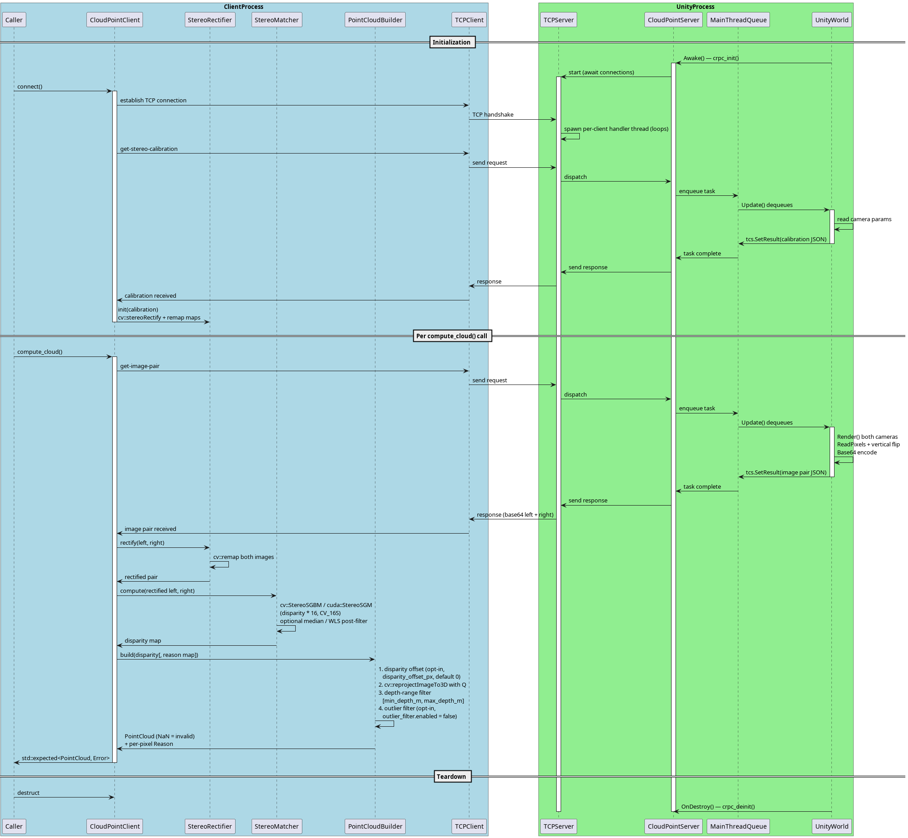

# Architecture

## Overview

The system follows a layered architecture for JSON-RPC 2.0 communication over TCP:

```
┌──────────────────────────────────────────────────────┐
│  Application / Unity                                  │
│  (registers callbacks via C API or server_main.cpp)   │
├──────────────────────────────────────────────────────┤
│  OpenCV Compute Layer (optional — requires opencv4)   │
│  CloudPointClient (facade: connect, compute_cloud,    │
│    write_ply)                                         │
│  ScaredDatasetLoader (SCARED stereo calibration +     │
│    image pair from disk; mm→m translation)            │
│  StereoRectifier (cv::stereoRectify + remap, Q mat)   │
│  PointCloudBuilder (SGBM disparity, reproject, NaN    │
│    filter)                                            │
├──────────────────────────────────────────────────────┤
│  RPC Layer                                            │
│  RpcServer (method dispatch, JSON-RPC 2.0 handling)   │
│  RpcClient (typed method calls via jsonrpccxx)        │
├──────────────────────────────────────────────────────┤
│  Service Layer                                        │
│  Service (mock camera data: intrinsics, extrinsics,   │
│  stereo calibration, image pairs)                     │
├──────────────────────────────────────────────────────┤
│  Transport Layer                                      │
│  TcpServer (accept loop, per-client threads — loops)  │
│  TCPConnector (client-side connector for jsonrpccxx)  │
│  tcp_read (framed read with size prefix)              │
├──────────────────────────────────────────────────────┤
│  Serialization                                        │
│  serialize.hpp (size embedding, numeric (de)serialize)│
│  rpc_coder (Base64 encode/decode)                     │
├──────────────────────────────────────────────────────┤
│  Config                                               │
│  ConfigLoader (YAML → ServerConfig + TestData)        │
└──────────────────────────────────────────────────────┘
```

All C++ code lives in the `score` namespace. The `rpc/` git submodule provides `jsonrpcxx` headers used by the client side.

## Communication model

The PlantUML diagram at `docs/communication_model.pu` describes the interaction flow:



1. **Unity side** initializes a `CloudPointServer` via `crpc_init()`, which starts a `TcpServer` awaiting connections.
2. **Client side** calls `CloudPointClient::connect()`, which opens a TCP connection and immediately fetches `get-stereo-calibration` once, initialising `StereoRectifier` with the returned intrinsics and geometry.
3. On each `compute_cloud()` call, the client fetches a synchronised image pair via `get-image-pair`, passes the decoded images through `StereoRectifier::rectify()`, then `PointCloudBuilder::build()` (SGBM disparity at 1/16 scale → `cv::reprojectImageTo3D` → NaN filter), and returns `std::expected<PointCloud, Error>` to the caller.
4. The server reads each request, dispatches it to `RpcServer`, which calls the registered handler (a C callback from Unity).
5. The Unity integration uses a **main-thread dispatcher**: RPC callbacks arrive on a C++ per-client thread and enqueue a `TaskCompletionSource` onto a `ConcurrentQueue`; the Unity `Update()` loop drains the queue and completes the task. A bounded timeout (~5000 ms) prevents deadlocks when the editor is paused.
6. The handler result is serialized back as a JSON-RPC response and sent over TCP; the per-client handler thread loops back to await the next request on the same connection.

See [docs/unity-integration.md](../docs/unity-integration.md) for the full Unity C# design spec.

## Wire framing

Every TCP message (both directions) uses a simple length-prefixed framing protocol:

- **Header**: 8 bytes — a `uint64_t` in native byte order containing the payload size.
- **Payload**: exactly `payload_size` bytes of JSON-RPC text.

This is implemented in:

- **`inplace_size_embedding()`** (`include/cloud_point_rpc/serialize.hpp`): Prepends the serialized `uint64_t` size to a `std::string`. Used by `TcpServer::handle_client` and `TCPConnector::Send`.
- **`tcp_read()`** (`include/cloud_point_rpc/tcp_read.hpp`): Reads the 8-byte header, deserializes the size, then reads the full payload — continuing to read if the payload arrives in multiple TCP segments.

```cpp
// Sending: embed size before the JSON payload
std::string response = processor_(payload);
response += "\n";
inplace_size_embedding(response);
asio::write(*socket, asio::buffer(response));

// Receiving: read 8-byte header, then full payload
std::array<char, 8> header;
asio::read(socket, asio::buffer(header, header.size()));
uint64_t packet_size = deserialize<uint64_t>(v);
std::vector<char> payload(packet_size);
asio::read(socket, asio::buffer(payload));
```

## TcpServer

`include/cloud_point_rpc/tcp_server.hpp`

- Accepts connections on a configurable IP/port using **asio**.
- Runs an **accept thread** (`std::jthread`) that blocks on `acceptor_.accept()`.
- Each client connection is handled in its own **`std::jthread`**; finished threads are cleaned up via a `std::list<pair<jthread, future<bool>>>` with periodic `remove_if`.
- The `RequestProcessor` (a `std::function<std::string(const std::string&)>`) is called for each incoming request — typically `RpcServer::process`.
- **`stop()`** unblocks the accept loop by first connecting a dummy socket to the listening endpoint (to avoid a race with `close()`), then closing the acceptor.
- Thread safety: `cliThrMtx_` guards the client thread list; `acceptorMtx_` guards the acceptor.

Key source: `include/cloud_point_rpc/tcp_server.hpp`

## RpcServer

`include/cloud_point_rpc/rpc_server.hpp`, `src/rpc_server.cpp`

- Maintains a `std::map<std::string, Handler>` of registered methods.
- **Handler** type: `std::function<std::variant<nlohmann::json, std::string>(const nlohmann::json&)>` — handlers can return either a JSON object or a raw string.
- Supports **two registration overloads**:
  - `register_method(name, Handler)` — for C++ lambdas/functors.
  - `register_method(name, callback_t)` — for C function pointers (`rpc_string* (*)(rpc_string*)`). The C callback receives the JSON params as a string and returns a string that is parsed as JSON if possible, or kept as a raw string otherwise.
- **`process(request_str)`** parses the JSON-RPC 2.0 request, validates required fields (`jsonrpc`, `method`, `id`), dispatches to the handler, and builds the response. Returns JSON-RPC error objects for parse errors (`-32700`), invalid requests (`-32600`), method not found (`-32601`), and server errors (`-32000`).

### Known issue

Non-object JSON requests (arrays, strings, numbers, null) throw `nlohmann::json::type_error` instead of returning a `-32600 Invalid Request` error. This is documented in `tests/test_rpc_edge_cases.cpp`.

## RpcClient

`include/cloud_point_rpc/rpc_client.hpp`

- Extends `jsonrpccxx::JsonRpcClient` from the json-rpc-cxx submodule.
- Wraps a `TCPConnector` as the transport connector.
- Provides typed methods: `get_intrinsic_params()`, `get_extrinsic_params()`, `get_cloud_point()`.
- Template `call<ReturnType>(name)` wraps `CallMethod` with an auto-incrementing request ID.

## TCPConnector

`include/cloud_point_rpc/tcp_connector.hpp`

- Implements `jsonrpccxx::IClientConnector`.
- On construction, opens a TCP connection to the server.
- `Send(request)` embeds the size prefix, writes the full message, then calls `tcp_read()` to receive the response.

## Service

`include/cloud_point_rpc/service.hpp`, `src/service.cpp`

- Holds `TestData` (intrinsic params, extrinsic params, cloud point).
- Returns configured data if available, otherwise returns identity-matrix fallbacks.
- Used by `server_main.cpp` for the standalone mock server. The C API path does not use `Service` — Unity provides its own handlers via callbacks.

## Config

`include/cloud_point_rpc/config.hpp`

- `ConfigLoader::load(path)` parses a YAML file into a `Config` struct.
- `Config` contains `ServerConfig` (ip, port) and `TestData` (camera parameters).
- Falls back to `127.0.0.1:8080` if no `server` section is present.
- Sample config: `config.yml` (server IP `127.0.0.1`, port `9095`).

## Executables

| Executable | Source | Description |
|---|---|---|
| `cloud_point_rpc_server` | `src/server_main.cpp` | Standalone server with mock `Service` data |
| `cloud_point_rpc_cli` | `src/main.cpp` | Interactive CLI client (menu-driven) |
| `minimal_client` | `src/minimal_client.cpp` | Minimal client that sends a hardcoded `ping` request |
| `scared_dataset_server` | `src/cloud_point/scared_dataset_server.cpp` | RPC server backed by a SCARED dataset keyframe directory for real-data validation (requires opencv4) |

### SCARED dataset validation

`scared_dataset_server` (`src/cloud_point/scared_dataset_server.cpp`) is a standalone RPC server that serves `get-stereo-calibration` and `get-image-pair` from a SCARED [endoscopic stereo dataset](https://huggingface.co/datasets/maxhallan7/scared) keyframe directory, so the full `CloudPointClient` stereo pipeline can be validated against real data instead of mock images. It reuses the standard wire protocol (see [RPC Protocol](rpc-protocol.md)) — no new RPC methods.

`ScaredDatasetLoader` (`include/cloud_point/scared_dataset_loader.hpp`) reads `endoscope_calibration.yaml` (OpenCV FileStorage with `M1`, `D1`, `M2`, `D2`, `R`, `T`) plus `Left_Image.png` / `Right_Image.png` (1280×1024 RGBA) from a keyframe directory. The YAML `T` is stored in millimetres; the loader divides by 1000 before populating `StereoCalibrationRPC.translation` (metres on the wire). The same images are returned on every `get-image-pair` call (single-keyframe source); the frame counter is `std::atomic<uint64_t>` (incremented per call) so it is safe under TcpServer's per-client handler threads. The constructor throws `std::runtime_error` if the left and right images have different dimensions.

Usage: `scared_dataset_server <keyframe_dir> [port]` (default port 8080).

The SCARED rig (fx ≈ 1024 px, baseline ≈ 4.35 mm) produces disparities above 128 px for tissue nearer than ~35 mm. `CloudPointClient` accepts a `num_disparities` constructor parameter (default 128; use 160 for SCARED) which is validated and forwarded to `StereoMatcherFactory::create` — it must be a positive multiple of 16 or `std::invalid_argument` is thrown. See [Build & Testing → SCARED Dataset E2E Test](build-and-testing.md#scared-dataset-e2e-test) for the test and run instructions.

## Shared libraries

| Library | Sources | Description |
|---|---|---|
| `libcloud_point_rpc` | `rpc_coder.cpp`, `rpc_dto.cpp`, `rpc_server.cpp`, `server_api.cpp`, `service.cpp` | Core RPC + server + config |
| `libcloud_point_rpc_cli` | `cli.cpp` | CLI client logic (links against core lib) |
| `test_cloud_point` | `test_api.cpp` | Test API library for method scheduling and auto-calling |

## Threading model

- **Server**: Accept thread + per-client handler threads (all `std::jthread`). Each client handler loops: it reads one request, processes it, sends the response, and then loops back to read the next request on the same connection. The connection remains open until the client disconnects (EOF) or an error occurs.
- **C API server** (`server_api.cpp`): The global `RpcServer` and `TcpServer` are guarded by `server_mtx`. The `rpc_string` garbage collector is guarded by `gc_mtx`.
- **Test API** (`test_api.cpp`): A `TestThread` runs a `std::jthread` with a condition-variable-driven loop that can auto-call registered methods at a configurable interval or process queued one-shot calls.